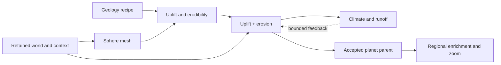

# Ordered terrain implementation plan

Updated 2026-10-06. **Active milestone: M2 — whole-planet relief.** The plan is now
**world-first**: one whole-planet relief made by uplift and erosion on an irregular
sphere mesh, then climate on the same mesh, then coupling, acceptance, a native
core and regional zoom. The 2026-10-06 [planet relief evidence](../research/2026-10-06-whole-planet-erosion-relief.md)
shows converged, isotropic, strictly descending river networks for a whole
synthetic world in seconds, which the local composed generator and the isolated
Landlab reference could not provide.

Keep one active milestone and at most one experiment needed to choose its next step.
This file owns execution order; WC/LE/R and A-F IDs identify supporting work,
not competing queues. [TODO](../../TODO.md) retains the complete feature backlog.

## Why the order changed (2026-10-06)

- Local rivers were planned on a coarse grid and carved into a composed noise
  surface. Repairs (ADR-0050–0056, T05–T13) did not make path and ground agree.
  Letting erosion form the relief makes them agree by construction.
- Climate is global: moisture crosses oceans and rain shadows cross continents.
  It needs a whole-world relief, which the per-continent AEQD path could only
  provide at M5.
- An irregular spherical mesh removes poles, seams and D8 direction bias at once.
  A fixed physical process scale makes relief statistics independent of mesh density.

## What works now

- World import, geographic context, geology recipes and bathymetry have their own
  usable workflows.
- **M2 experimental product:** `dmtools world planet` ([guide](../world-planet.md),
  [ADR-0085](../adr/0085-generate-planet-relief-on-a-sphere-mesh.md)) evolves the
  whole planet from a saved world. It uses procedural forcing, or a geology recipe
  as calibrated forcing, and runs the provisional
  [climate v0](../research/2026-10-06-planet-climate-v0.md) with runoff-weighted
  erosion and biomes. It publishes a world-aligned GeoTIFF, atlas images, river
  vectors and the authoritative mesh archive. `benchmarks.planet` keeps synthetic
  test worlds, sample geology and resolution sweeps.
- **Local terrain path (unchanged):** World → Terrain, the composed generator/editor,
  builds, profiles and saved-parent experiments. M1 context binding is experimental.
  The local path remains available until M5 decides what replaces it.

## Next implementation order

| Order / state | Deliverable and required connections | Completion evidence | Existing owners |
|---|---|---|---|
| **M1 — implemented, experimental** | Context-bound local rough terrain (one landmass, AEQD). | [Evidence](../research/2026-09-28-context-bound-rough-terrain.md), ADR-0084. | WC1/WC2 |
| **M2 — ACTIVE** | **Whole-planet relief.** Sphere mesh, uplift + stream-power erosion with coast as base level, fixed process scale, ocean floor from coast distance/bathymetry settings. Consume geology recipes (setting, ages, landform intent) as uplift/erodibility; procedural default without one. Product command, world-placed exports (equirectangular GeoTIFF on the custom sphere, mesh archive, river vectors, preview). | Coast invariant; zero non-descending receivers; isotropic flow; relief statistics converge with mesh density; geology controls change relief for declared reasons; deterministic repeat; ADR for mesh/TIN surface authority. | WC2, LE1/LE3, R01/R02/R07, TODO:444 |
| **M3 — queued** | **Climate v0 and provisional biomes** on the planet mesh: latitude/lapse temperature, wind belts from planet settings, upwind moisture with orographic lift and rain shadow, runoff, Whittaker/Köppen-style labels marked provisional. | Windward/leeward and coastal/interior controls respond for declared reasons; water budget closes; units and assumptions explicit; exposure is never relabelled as rainfall. | WC3, WC6 (provisional), R07/R10/R33 |
| **M4 — queued** | **Coupled, inspectable planet workflow.** Runoff-weighted erosion with bounded climate feedback; lakes/endorheic basins; World-tab stage with preview, compare, regenerate, cancel and stale state. | A user can run, inspect, change an input and regenerate the whole path; nonconvergence is visible. | WC3/WC4, LE5, R27/R32 |
| **M5 — queued** | **Accepted world parent and native core.** Realism metrics on reference worlds, adoption ADR, then port the stabilised kernels (mesh, routing, erosion, climate) to the native core with differential tests. Decide what replaces the local composed generator. | Reference-world gallery and metric thresholds; Python/native agreement within declared tolerances; packaged dependency audit. | LE2/LE3, A/B/C, R25/R40–R48 |
| **M6 — after an accepted parent** | **Regional enrichment and zoom** from the planet parent: finer local mesh, parent boundary heights and inflows, smaller process scale, then sub-process-scale amplification. | Adjacent/overlapping requests agree; inherited flow conserved; revisits do not age terrain again. | LE6, WC5, D, R15/R34, ADR-0048 |
| **M7 — deferred** | Water/materials and selected landforms (discharge widths, lake storage, sediment, glacial, volcanic, karst) when integrated results expose a need. | Each mechanism has its own control and conservation ledger. | LE4, E |
| **M8 — deferred** | Accepted ecology and stronger planetary models. | Traceable classifications and uncertainty. | WC6, F |

## Planned data flow

## Concrete next batch: M2

Done: the geology mapping, promotion to `src` with stage seeds, cancellation and
progress, `dmtools world planet` with manifest-last outputs, and ADR-0085.

Also done: lakes (open and closed), craton marginal swells, and the World-tab
**Planet** stage with layers, hover inspection and export.

M6 has an early experimental product slice: parent-calibrated regional detail from
window-independent blended tiles ([ADR-0086](../adr/0086-regional-planet-detail-from-blended-tiles.md),
[evidence](../research/2026-10-06-regional-enrichment-tiles.md)), with a World-tab zoom.

The first authored world (9 continents, 185 shapes) ran end to end
([report](../research/2026-10-06-first-authored-world-planet.md)); ice-sheet lakes and
rivers were fixed.

Next:
1. Authored geology for real worlds; optional derived coast refinement for zoom.
2. Consume the bathymetry product for the ocean floor, or record why not.
3. Expose planet climate assumptions (obliquity, temperatures, winds) in the panel.

## Integration checks and adoption checks

| Always required, including experiments | Required before default adoption or stronger claims |
|---|---|
| Preserved source geography and declared authored-input roles; explicit units, coordinates, time, dependencies and deterministic seeds. | Reference-world realism metrics and authoring coverage; accepted relief/river correspondence. |
| Finite numeric state, valid masks, declared corrections, step/output budgets, cancellation and honest incomplete results. | Calibrated physical assumptions, conservation evidence for advertised capabilities, parent consistency and distribution/license review. |
| Supported inputs enforced; failures distinguished from unsupported cases; experimental status retained on save/reopen. | A reviewed adoption decision on the integrated application, not only a benchmark. |

## Deliberately deferred

Further local ridge/valley/bank polish (B1/B2), noise-certification bounds, new
water-review evidence, GPU work and speculative tuning. The native rewrite waits
for M5 so it ports the stabilised planet core, not the local composed generator.
Numba is used for research/prototype kernels.

## Keep this plan current

Before selecting work, read this file and the [decision catalog](../research/decision-catalog.md).
For every substantive implementation or experiment, update in the same commit:

1. This page's date, active milestone and last result (implemented, experimental,
   accepted, blocked, deferred or rejected).
2. Affected [TODO](../../TODO.md) items and [current status](../research/status.md).
3. The catalog's affected decision; failed methods go to the
   [method register](../research/terrain-method-decisions.md).
4. A dated report for material new measurements; an ADR when architecture changes.
5. Links and the [file inventory](../FILE_INDEX.md) when files change.

Unknown or untested is not rejected. Consult before tests expected to exceed
roughly two minutes unless the user has authorized long experiments.
